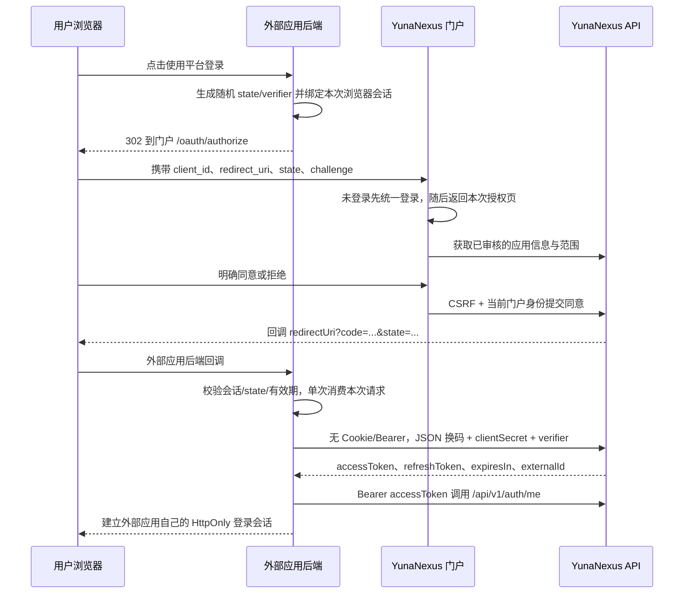

# YunaNexus 外部应用 OAuth 接入指南

本文对应本仓库实现，面向有独立后端的外部应用。请结合 `docs/api-contract.md` 使用。示例不包含任何真实密钥。

## 1. 当前地址和协议边界

| 用途 | 当前测试地址 |
| --- | --- |
| 用户门户与浏览器授权页 | `http://103.39.66.135:3000` |
| 外部应用后端调用的 API 基址 | `http://103.39.66.135:3000` |
| 平台管理台 | `http://103.39.66.135:3001` |

域名和 HTTPS 上线后，通过环境变量统一替换门户/API 基址。当前 HTTP 地址用于联调；正式对接应使用 HTTPS 保护授权码、账号登录和令牌传输。不要关闭证书验证来接入未来 HTTPS 地址。

平台提供“授权码 + PKCE S256 + 机密客户端凭证”的登录授权流程。当前接口采用 **JSON、自定义参数名和 Result 包装**，不能把默认 OAuth SDK 的地址填好后就假设兼容：

- 浏览器入口为 `/oauth/authorize`，采用下文列出的查询参数。
- 换码端点为 `POST /api/v1/auth/sso/token`，请求是 JSON，字段为 `clientCode`、`redirectUri`、`codeVerifier`、`clientSecret`。
- 不提供 OIDC Discovery、JWKS、ID Token、标准 `/userinfo` 或标准 token introspection 接口；不要把 access token 当作 ID Token。
- 不支持隐式流、密码流、客户端凭证流、无后端的公共客户端或任意第三方动态注册。
- 外部应用必须有后端保管 clientSecret、verifier、accessToken 和 refreshToken；不要放入网页构建产物、URL 或移动端安装包。

## 2. 申请应用与上线准备

1. 使用普通平台账号登录门户，进入“应用接入”，创建应用。
2. 填写应用名称、说明、网站、回调地址和需要的权限范围。
3. 保存创建结果中的 `clientId` 和只显示一次的 `clientSecret`。API 字段 `clientCode` 使用这个 `clientId`，形如 `oauth_...`。
4. 将 clientSecret 保存到外部应用后端的 Secret Manager 或受限环境变量，不提交到公开仓库。
5. 等待平台管理员审核通过。审核不等于替用户授权；每个用户需在授权页明确同意。
6. 在自己的站点增加“使用 YunaNexus 登录”按钮，指向**自己的后端登录发起路由**，由自己的后端生成 state/verifier。

回调地址最多 10 个，每个必须精确匹配登记值，包括协议、域名、端口、路径、结尾斜杠和原有查询参数。生产回调只允许 HTTPS；本机 `http://localhost` 和 `http://127.0.0.1` 可用于开发。禁止通配回调、用户信息段、URL fragment、换行和预先携带 `code` / `state` 参数。

每个账号最多保留 100 条应用记录，同时最多 20 个未删除应用。应用编辑后重新进入审核，并撤销该应用之前的用户授权；重新启用后用户须再次同意。重置客户端密钥后旧密钥不能再换码。删除/停用应用会阻止后续访问，不能通过保留旧令牌绕过。

## 3. 权限范围与 API 对照

| 范围 | 允许的能力 | 限制 |
| --- | --- | --- |
| `profile:read` | `GET /api/v1/auth/me`，基础身份、昵称和头像引用 | 不包含密码、管理权限或内部用户 ID |
| `email:read` | 配合 `profile:read` 读取 `GET /api/v1/user/profile` | 返回的是个人资料联系邮箱，不是找回密码邮箱 |
| `files:read` | `GET /api/v1/file/me`、`GET /api/v1/file/me/{id}/download` | 只能访问令牌所属用户的文件 |
| `files:write` | `POST /api/v1/file/me/upload`、`POST /api/v1/file/me/{id}/rename`、`POST /api/v1/file/me/{id}/delete` | 不隐含读取权限；上传与删除可能改变用户数据 |
| `notice:read` | `GET /api/v1/notice/inbox`、`GET /api/v1/notice/inbox/summary`、`GET /api/v1/notice/inbox/{noticeId}` | 不能标记已读、发送通知或读取其他用户记录 |

目前授权页展示该应用经审核的完整范围，用户选择整体同意或拒绝；请求方不能通过追加 scope 参数扩大授权。建议只申请业务必需的最少范围。

即使授权用户是超级管理员，外部 OAuth 令牌也不能访问管理接口、个人 API Key 管理、账号安全设置或权限中心。`externalId` 用作外部应用的稳定用户关联键，昵称、邮箱可变，不能作为唯一账号主键。头像可能是 `file:ID` 文件引用，不能直接当作图片 URL；没有文件读取权限时不要尝试绕过下载校验。

## 4. 完整时序



### 4.1 发起浏览器授权

每次登录生成独立的 32 字节随机 state 和 verifier，使用无填充 Base64URL 编码得到 43 字符。不要使用固定 state、用户 ID、时间戳或固定 verifier。

`code_challenge = BASE64URL(SHA256(ASCII(code_verifier)))`，不带 `=` 填充。

浏览器跳转：

```text
GET {PORTAL_BASE}/oauth/authorize
    ?client_id={登记的clientId}
    &redirect_uri={URL编码后的完整回调地址}
    &state={43至256字符的随机state}
    &code_challenge={43字符的S256结果}
    &code_challenge_method=S256
```

verifier 只保留在外部应用后端，不能放在此 URL。state、verifier、redirectUri、创建时间应绑定到同一个浏览器登录请求，建议最多存活 5 分钟，并限制同一会话的未完成请求数。用户在门户注册后也会返回原授权页，无需手动刷新。

### 4.2 授权同意与拒绝

用户必须在平台页面确认应用名称、回调目标与权限清单。外部应用不能代替用户提交同意，也不应在 iframe 中嵌入授权页面。门户内部使用当前验证后的 web 身份，避免误用浏览器里其他账号残留的 Cookie。

同意后回调包含 `code`、`state`；授权码有效期由服务器配置决定，最多 60 秒，且只能消费一次。拒绝后，已验证回调会收到 `error=access_denied&state=...`，外部应用只清理本次请求并返回登录页，不反复自动重试。

### 4.3 校验回调并换码

外部应用后端必须先校验 state 与自己保存的请求一致、绑定的是当前浏览器会话、未过期且未消费。state 不是服务端 token 端点替应用自动完成的防护。

```http
POST /api/v1/auth/sso/token
Content-Type: application/json
Accept: application/json
```

```json
{
  "clientCode": "oauth_替换为登记的clientId",
  "redirectUri": "http://127.0.0.1:5000/callback",
  "code": "回调获得的43字符授权码",
  "codeVerifier": "本次请求保存在外部应用后端的verifier",
  "clientSecret": "从后端私有配置读取"
}
```

此端点**禁止携带 SSO Cookie 或 Authorization 头**；不要复用用户浏览器 Cookie，也不要用带默认 Bearer 的业务 HTTP 客户端调用。它不要求 CSRF 令牌，授权码、PKCE 和客户端凭证共同约束换码。

成功响应示意：

```json
{
  "code": 200,
  "msg": "success",
  "data": {
    "accessToken": "仅保存到外部应用后端",
    "refreshToken": "仅保存到外部应用后端",
    "expiresIn": 1800,
    "externalId": "用户的外部标识"
  }
}
```

`expiresIn` 使用响应实际值，不要硬编码示例中的 1800。同时检查 HTTP 状态和 `code === 200`，不能仅判断 HTTP 200。换码超时结果未知时不要无限重试同一个 code；重新发起新的授权请求。

### 4.4 获取身份并建立自己的登录会话

```http
GET /api/v1/auth/me
Authorization: Bearer {accessToken}
```

按 `data.externalId` 关联自己的用户表，再给浏览器设置自己应用的随机 HttpOnly 会话 Cookie。生产 Cookie 使用 Secure、SameSite=Lax 和合理的有效期。自己的业务权限由自己的后端判断，不从昵称或未验证的 JWT 解码结果推断管理员身份。

## 5. 最小 Node.js 后端流程示例

下面是路由处理核心，使用 Node 原生 `crypto` 与 `fetch`；请接入你现有的服务端 Session 框架。`session` 必须来自服务端校验的会话，不能直接信任浏览器 JSON。示例不依赖前端保存令牌。

```js
import { randomBytes, createHash } from 'node:crypto'

const PORTAL = process.env.YUNA_PORTAL_BASE || 'http://103.39.66.135:3000'
const API = process.env.YUNA_API_BASE || PORTAL
const CLIENT = process.env.YUNA_CLIENT_ID
const SECRET = process.env.YUNA_CLIENT_SECRET
const CALLBACK = process.env.YUNA_CALLBACK_URL
if (![CLIENT, SECRET, CALLBACK].every(Boolean)) throw new Error('Missing OAuth configuration')
const random = () => randomBytes(32).toString('base64url')

export function startLogin(session) {
  const state = random(), verifier = random()
  session.yunaPending = { state, verifier, createdAt: Date.now() }
  const url = new URL('/oauth/authorize', PORTAL)
  url.search = new URLSearchParams({
    client_id: CLIENT, redirect_uri: CALLBACK, state,
    code_challenge: createHash('sha256').update(verifier, 'ascii').digest('base64url'),
    code_challenge_method: 'S256',
  }).toString()
  return url.toString() // 先持久化 session，再返回 302
}

async function result(response) {
  const body = await response.json()
  if (!response.ok || body.code !== 200) throw new Error('YunaNexus request failed')
  return body.data
}

export async function finishLogin(session, query) {
  const pending = session.yunaPending
  delete session.yunaPending // 单次消费；持久化此变更，防止并发回调重复使用
  if (!pending || typeof query.state !== 'string' || query.state !== pending.state ||
      Date.now() - pending.createdAt > 300000 || pending.createdAt > Date.now()) {
    throw new Error('Invalid login state')
  }
  if (query.error === 'access_denied') return { cancelled: true }
  if (typeof query.code !== 'string' || !/^[A-Za-z0-9_-]{43}$/.test(query.code)) {
    throw new Error('Invalid authorization code')
  }
  const tokens = await result(await fetch(`${API}/api/v1/auth/sso/token`, {
    method: 'POST', redirect: 'error', signal: AbortSignal.timeout(10000),
    headers: { 'Content-Type': 'application/json', Accept: 'application/json' },
    body: JSON.stringify({ clientCode: CLIENT, clientSecret: SECRET,
      redirectUri: CALLBACK, code: query.code, codeVerifier: pending.verifier }),
  }))
  const me = await result(await fetch(`${API}/api/v1/auth/me`, {
    redirect: 'error', signal: AbortSignal.timeout(10000),
    headers: { Authorization: `Bearer ${tokens.accessToken}`, Accept: 'application/json' },
  }))
  // 保存令牌到服务端受限存储，数据库中只按 externalId 关联用户。
  // 成功后旋转自己的会话 ID，防止 session fixation；不要将 tokens 返回给浏览器。
  return { externalId: me.externalId, nickname: me.nickname, tokens }
}
```

不要把回调查询字符串写入访问日志，也不要把上例返回对象直接序列化给浏览器。生产环境应使用持久化会话、原子消费 pending、幂等用户关联和受限令牌存储。示例中的“单个 pending”适合一次登录；多标签并行登录可改为按 state 索引、设置短 TTL 的服务端记录。

## 6. 续期、退出与撤销

- `POST /api/v1/auth/refresh`，JSON `{refreshToken}`：刷新令牌单次轮转，必须原子保存新 accessToken/refreshToken。一个用户应用会话的续期应使用互斥锁/单航班，避免并发消费同一个 refreshToken。
- refresh 和普通认证中心写接口仍受 CSRF 校验。服务端调用前，用独立 Cookie jar 请求 `GET /api/v1/auth/csrf`，保存返回的 CSRF Cookie，随后在同一 jar 中发送 `data.headerName: data.token`。只保留自己的 CSRF Cookie，不能转发平台浏览器的 SSO Cookie。
- `POST /api/v1/auth/logout` 加该应用 Bearer 令牌，撤销当前应用会话；同样按上一项处理认证中心 CSRF。外部应用还需清理自己的会话和服务端令牌。
- 不调用 `/logout-all` 替代应用退出；外部 OAuth 令牌不具有此范围。
- 用户可在门户“已授权应用”撤销该应用；现有客户端会话会被移除，刷新/新授权也受授权状态校验。应用收到 401/403 时清理本地授权状态，引导用户重新同意，不自动无限重试。
- 停用、删除或重新审核应用会阻止访问。密钥轮换只使旧密钥无法换码，不等于对所有已发令牌执行全局注销；如需立即停止全部访问，应停用应用并核对业务影响。

## 7. 错误排查

| 现象 | 优先检查 |
| --- | --- |
| 授权页提示应用不存在 | client_id 是否为真实 clientId，应用是否通过审核且启用 |
| 回调地址不匹配 | 是否与登记地址逐字符一致，换码是否使用同一 redirectUri |
| state 错误 | 同一浏览器会话是否保留 pending，是否跨 localhost/127.0.0.1，是否重复回调 |
| PKCE 失败 | SHA256 输入是否原 verifier，Base64URL 是否去掉填充，是否误用普通 Base64 |
| token 端点拒绝 Cookie/Bearer | 是否复用了浏览器 Cookie jar 或带默认 Authorization 的 HTTP 客户端 |
| 客户端凭证无效 | 是否使用创建/轮换时保存的最新 clientSecret，是否把 clientId/id 混淆 |
| 已读写接口 403 | 对照上面的真实 API 白名单，files:write 不隐含 files:read |
| 刷新接口 403 | 是否先获得同一 Cookie jar 的 CSRF Cookie 和掩码令牌 |
| 数据看似成功但字段为空 | 同时检查 HTTP 与 Result.code，校验 data 结构，保留 traceId 排查 |

## 8. 上线验收清单

- 使用普通用户而非只有应用所有者完成登录、同意、拒绝、刷新和退出。
- 验证陌生回调、伪造 state、错误 verifier、错误 secret、过期/重复 code 全部失败。
- 只读应用无法上传/重命名/删除文件；所有应用均无法访问管理和账号安全接口。
- 撤销授权、修改应用范围重新审核、停用应用后旧令牌不能继续访问。
- 浏览器、前端产物、日志、监控、错误页、Git 历史中均不出现 clientSecret 或令牌。
- HTTPS、会话 Cookie、并发续期、回调日志脱敏、失败重试上限和凭证轮换流程已实际验证。

本指南描述应用实际支持的协议，不承诺未实现的 OIDC/标准 SDK 自动兼容能力。后续若提供标准化适配端点，应版本化发布并保留当前应用的兼容迁移期。
